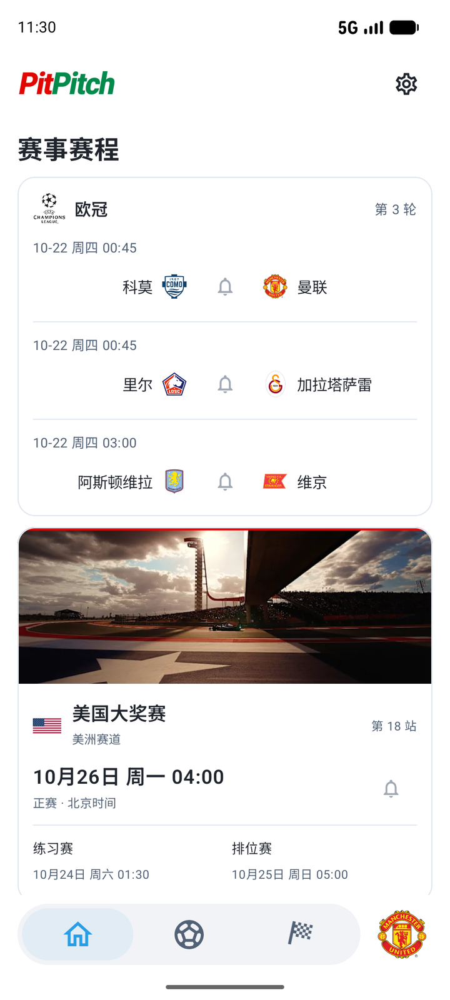

# PitPitch

PitPitch 是面向个人的足球与 F1 赛程应用，支持赛历查看和积分查看，并提供赛前提醒，以免在休赛期之后错过精彩赛事。

- [下载 Android 安装包](https://github.com/cgl-sd/PitPitch/releases/download/v0.8.0/PitPitch-0.8.0.apk)
- [下载 iOS 安装包（DMG）](https://github.com/cgl-sd/PitPitch/releases/download/v0.8.0/PitPitch-0.8.0-iOS.dmg)

支持 Android 8.0 及以上，iOS 26.0 及以上。


## 功能

**首页**：按所选赛事展示足球下一轮和 F1 比赛周末，默认英超、欧冠与 F1。主队默认曼联，可在设置中修改。

**足球**：覆盖英超、西甲、意甲、德甲、法甲、欧冠和欧联，保留 2020/21 赛季起的数据。赛程按轮次连续浏览，积分榜使用来源排名与积分，球员栏目提供进球榜和助攻榜。

**比赛与球队**：比赛详情包含比分、状态、技术统计、进球与红牌事件、已发布首发和阵型；球队页展示主色、联赛排名、赛程与名单。

**F1**：保留 2020 赛季起的赛历、排位、正赛结果及车手/车队年度积分。分站和赛道使用本地中文名，历史赛道图片按赛季与真实路线关联。

**提醒**：点击铃铛预约开赛前五分钟通知。首次预约时按需申请通知和精确提醒权限，不读写系统日历；取消预约不依赖权限。

| 首页 | 足球赛程 | 足球积分 |
| :---: | :---: | :---: |
| [](artwork/readme/home.png) | [](artwork/readme/football-schedule.png) | [](artwork/readme/football-standings.png) |

| F1 赛程 | 车手积分 | 车队积分 |
| :---: | :---: | :---: |
| [](artwork/readme/f1-calendar.png) | [](artwork/readme/f1-drivers.png) | [](artwork/readme/f1-constructors.png) |

> 截图为 Android 开发版界面。

## 使用

赛程、历史成绩和打包图片优先从本地读取。应用打开后会在后台刷新；首页下拉或双击底栏首页按钮可手动刷新。刷新失败时保留已有内容，首页底部显示最近成功获取数据的实际时间。

网络请求共用连接池并限制并发，默认连接/读取 12 秒、单请求总时限 20 秒、JSON 不超过 16 MiB。历史比赛不会被刷新删除，网络失败也不会以空数据覆盖有效缓存。

## 下载与安装

1. 下载 [PitPitch-0.8.0.apk](https://github.com/cgl-sd/PitPitch/releases/download/v0.8.0/PitPitch-0.8.0.apk) 和同页 `.apk.sha256`。
2. 按 Android 提示允许当前来源安装并确认安装。应用尚未上架应用商店。
3. 旧版可直接覆盖安装，偏好与本地数据会保留；包名和签名证书必须一致。

设置中的“检查更新”读取 GitHub 正式 Release。经用户确认后下载，核验 SHA-256、大小、包名、版本与签名，再交由 Android 系统安装器确认。不能静默安装或清空用户数据。

## 数据与资源

PitPitch 使用公开赛事资料建立本地归档，不是官方授权应用，也不提供秒级直播或 F1 遥测。足球历史从 2020/21、F1 从 2020 起持续保留。

| 内容 | 来源 | 许可与权利说明 |
| --- | --- | --- |
| 足球赛程、比分、积分、榜单与详情 | ESPN 公开端点 | 保留原始赛事事实；公开可访问不代表开放许可或官方授权 |
| F1 赛历、排位、正赛与积分 | Jolpica | 保留来源结果；接口访问不代表图片或商标获授权 |
| 足球补充轮次 | OpenFootball、FixtureDownload | OpenFootball 为 CC0；FixtureDownload 保留来源记录 |
| 球队与球场中文名 | Wikidata、人工核验的中文体育媒体常用名 | Wikidata 结构化资料为 CC0；媒体常用名逐条记录来源 |
| 赛道参考地图 | [bacinger/f1-circuits](https://github.com/bacinger/f1-circuits) | MIT · © 2019–2025 Tomislav Bacinger |
| 历史赛道轮廓 | Wikimedia Commons | 按条目采用 CC BY-SA 3.0/4.0、CC0 或公有领域；署名索引随包保留 |
| 队徽、人物、赛车与现场图片 | 各图片原始来源 | 版权及商标权归各权利人，不统一视为开源素材 |
| 启动字标字形 | Roboto | SIL Open Font License 1.1 |

必要署名及许可原文随应用保留，“隐私和关于”提供简要说明。

### 内容边界与隐私

- 缺失数据保持未知，不造比分、轮次、首发、赛果或积分；未公布的对阵与场地显示“待定”。
- 足球球员保留 ESPN 英文全名；球队和球场优先使用已核验中文名，无法唯一确认时保留原名。
- 主队与首页偏好保存在本地；数据库和网络缓存可重建，提醒及下载关联不参与备份。
- 赛事刷新、图片加载和版本检查会连接相应服务，对方可收到 IP 地址等正常请求信息。

## 开发与构建

Android 使用 Kotlin、Jetpack Compose、Material 3、Navigation Compose、ViewModel + StateFlow、Room 和 DataStore。

工具链：JDK 17、Gradle 8.9、AGP 8.7.3、Kotlin 2.0.21、compile/target SDK 35，最低 API 26。

使用 Android Studio 打开 `android/`，将 Gradle JDK 设为 17，通过本机 `local.properties` 或 `ANDROID_HOME` 配置 SDK。离线构建与单测：

```bash
./android/gradlew -p android --offline :app:assembleDebug :app:testDebugUnitTest
```

Release 构建：

```bash
./android/gradlew -p android --offline :app:assembleRelease
```

Release 启用 R8 代码精简与资源裁剪。默认产物未签名；可在本机未跟踪的 `android/keystore.properties` 中配置 `storeFile`、`storePassword`、`keyAlias` 和 `keyPassword`。证书必须与原安装包一致。

普通 Gradle 构建不会联网抓取资料。归档变更后运行：

```bash
python3 tmp/tests/build_local_backend_manifest.py --verify
```

## 目录

- `android/`：Android Gradle 工程。
- `shared/assets/`：赛事归档、图片、中文名、轮次、来源和许可。
- `shared/branding/`：品牌与界面图片。
- `tools/data/`：离线资料整理及显式联网采集工具。
- `tmp/tests/`：单元测试、设备测试和共享资源校验源码。
- `tmp/validation/`：忽略的本机构建、日志和验收证据。

Android 设备核验使用专用 `Pixel_8_API37`。操作前通过 `adb -s SERIAL emu avd name` 核认真实设备，禁止借用其他项目设备。
