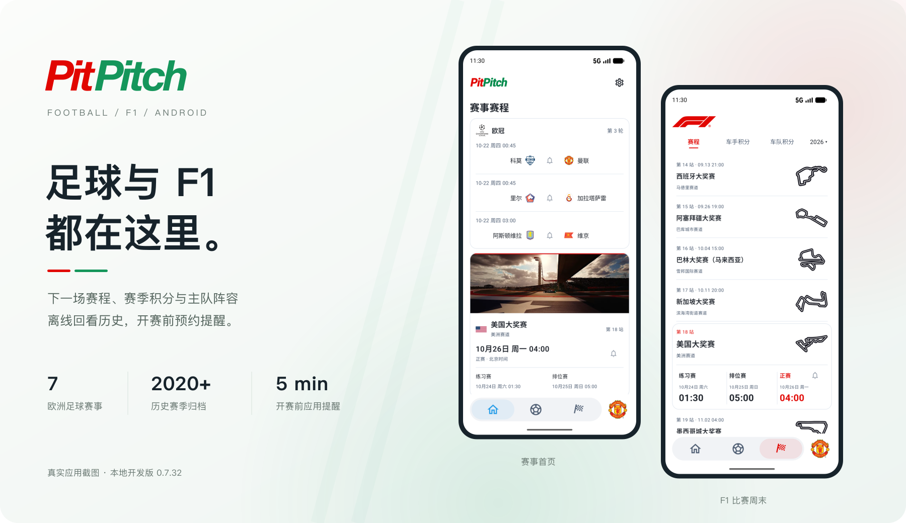
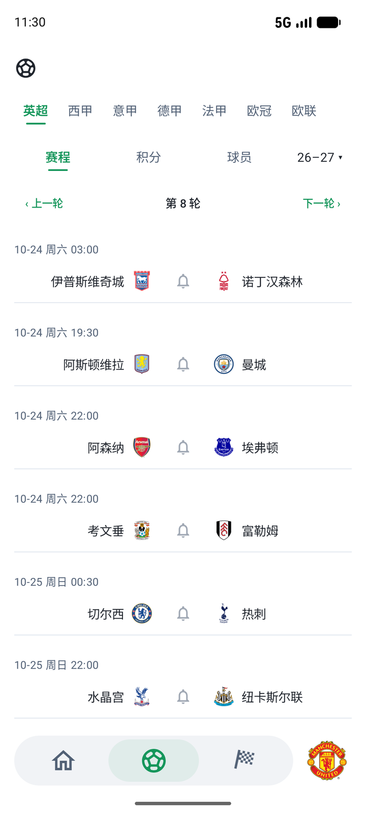
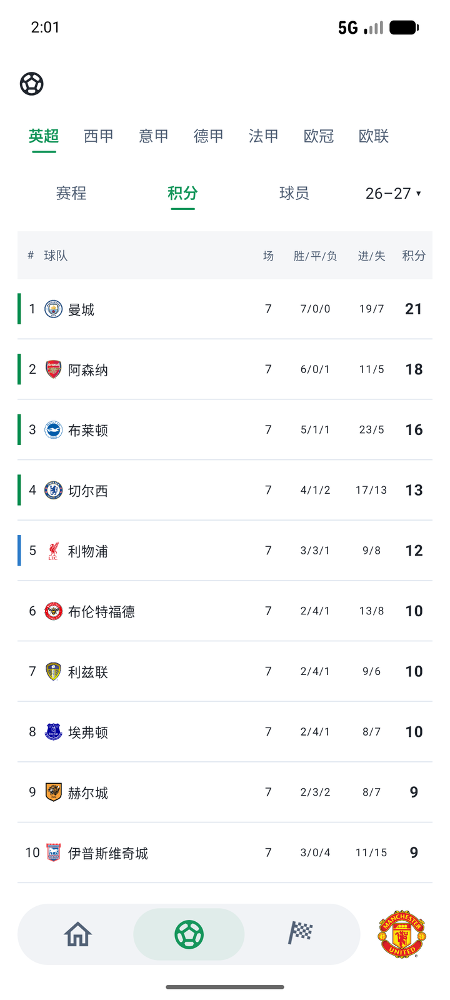
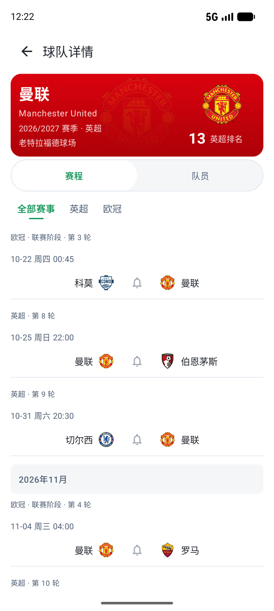
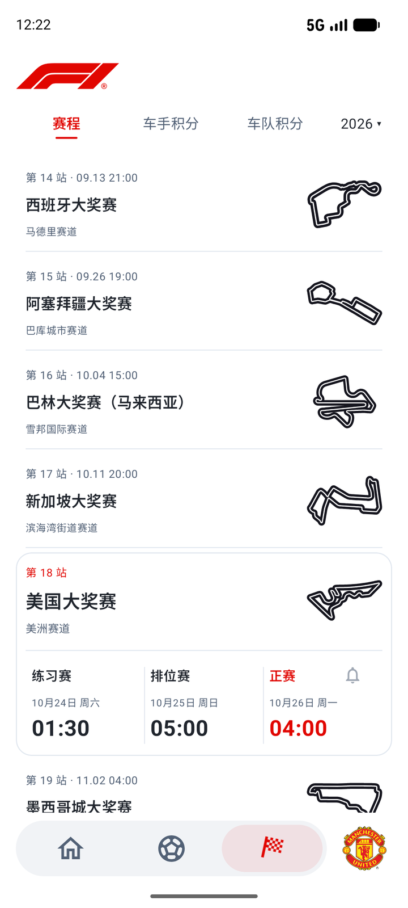
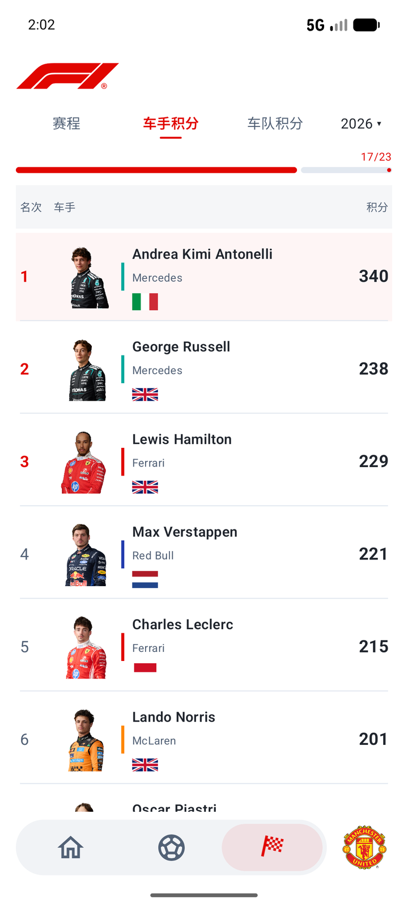
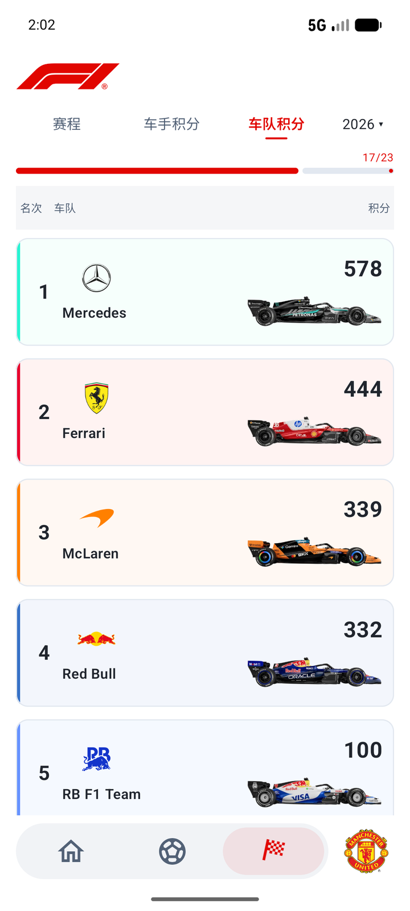
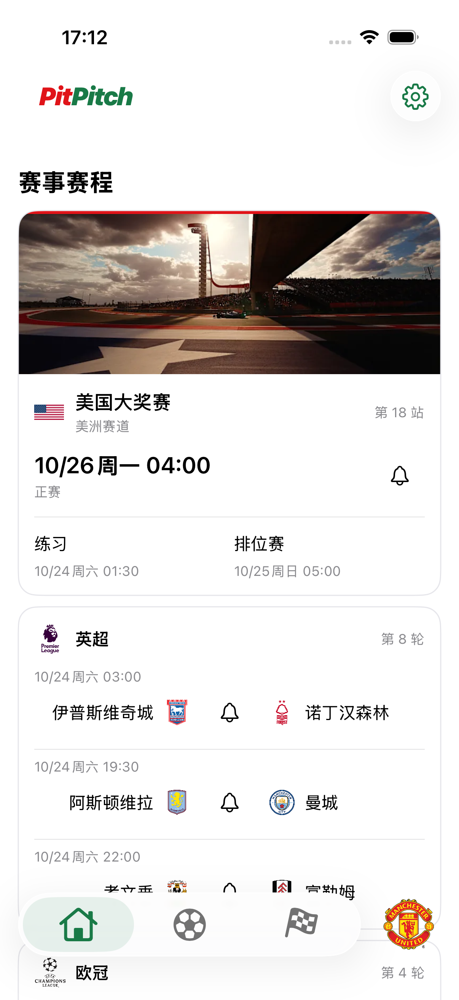
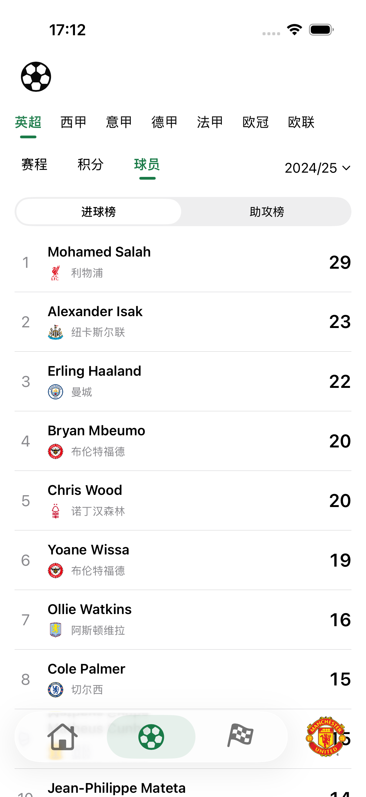
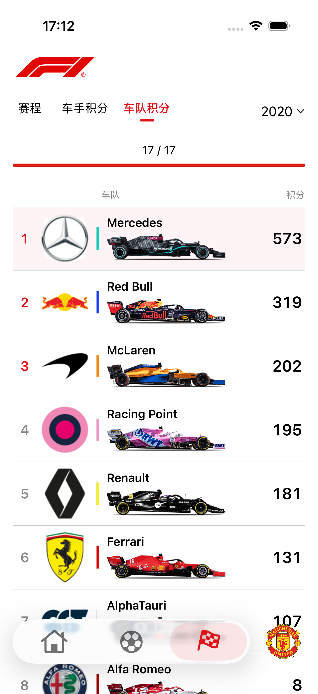

# PitPitch

PitPitch 是一个查看足球与 F1 赛程的应用。Android 与 iOS 使用各自的原生界面，共用真实赛事归档和图片资源。

足球覆盖英超、西甲、意甲、德甲、法甲、欧冠和欧联，保留 2020/21 赛季起的记录；F1 从 2020 赛季起，包含赛历、排位、正赛以及车手和车队年度积分。应用默认定位下一场比赛，也能回看历史赛季，并在开赛前发送提醒。



[下载 Android 安装包](https://github.com/cgl-sd/PitPitch/releases/download/v0.7.39/PitPitch-0.7.39.apk) · [Android 发布说明与校验文件](https://github.com/cgl-sd/PitPitch/releases/tag/v0.7.39) · [iOS 0.2.12 源码预览](https://github.com/cgl-sd/PitPitch/releases/tag/ios-v0.2.12) · [自行构建](#开发与构建)

Android 8.0 及以上，无需注册。已归档的内容可以离线浏览。iOS 需使用 Xcode 构建；GitHub 上的 iOS Release 仅提供源码预览，不提供未签名 IPA。

## 首页

首页只展示所选赛事。默认是英超、欧冠和 F1，可在设置中修改；该设置不影响各栏目里的完整赛程。足球按轮次预览，F1 显示当日或下一站的比赛周末。底栏右侧的主队队徽进入球队主页，主队默认为曼联。

## 足球：赛程、积分与主队

七项赛事的历史均从 2020/21 赛季保留。

| 完整赛程 | 联赛积分 | 主队主页 |
| :---: | :---: | :---: |
| [](artwork/readme/football-schedule.png) | [](artwork/readme/football-standings.png) | [](artwork/readme/team.png) |
| 连续浏览全年比赛，按轮次跳转 | 查看官方来源排名与积分 | 从下一场开始，也能回看已完场比赛 |

赛程按轮次连续展示，积分榜使用来源排名与积分。比赛详情包含比分、状态、技术统计、进球与红牌事件，以及来源已发布的首发和阵型。已有首发统一用球场图展示：优先采用本场已核对站位，位置不完整时标注“站位示意”，不补造缺失球员或阵型名称；七项赛事共用中央细轴、左右浅灰卡片和居中阶段节点；事件比分只读取对应供应商原文，名称差异按同一球队 ID 下的供应商名称精确核验。点击双方队徽进入对应球队主页。球员栏目提供进球榜和助攻榜。欧战分为联赛阶段（2024 年前为小组赛）与淘汰赛两个阶段。

## F1：赛历、成绩与积分

覆盖 2020 赛季起的全年赛历、排位成绩、正赛结果，以及车手和车队年度积分。分站与赛道使用统一的本地中文显示名称，首页、赛程、详情及新建提醒保持一致，供应商原名和比赛事实仍按原样保存。

| 比赛周末 | 车手积分 | 车队积分 |
| :---: | :---: | :---: |
| [](artwork/readme/f1-calendar.png) | [](artwork/readme/f1-drivers.png) | [](artwork/readme/f1-constructors.png) |
| 当日或下一站默认定位，完整赛历上下浏览 | 对应人物图片、队色与来源积分 | 同赛季赛车图片，紧凑列表布局 |

车队积分采用白底细横线列表，各赛季共用一致的队徽、队名、名次、积分与赛车位置；队名与下方赛车左对齐，图片按可见图形范围统一大小，显示名称省略末尾的“F1 Team”。车队与车手积分共用图片槽位、队色竖线和文字列比例；色条按赛季采用车队识别色（[2026 F1 官方车队页](https://www.formula1.com/en/teams)，历史赛季参考 [FastF1 官方色表](https://github.com/theOehrly/Fast-F1/blob/main/fastf1/plotting/constants.json)中的 official 字段）；车手人像统一脸部大小与取景，保留真实赛季图片。

首页的 F1 卡片按设备当日日期读取当年赛历，不受栏目中所选赛季影响；当年没有后续比赛时不显示。赛程卡片列出练习、排位和正赛，冲刺赛等场次在赛程与详情中保留，正赛标题旁可直接预约提醒。排位显示最后参加阶段的圈速，正赛结果包含退赛和零分车手。

> 截图为本地开发版 **0.7.35** 的 Android 界面，内容取自本地归档，不是实时数据。截图只做过缩放和排版，赛事、积分和人物信息未改动。**0.7.35** 发布版采用相同页面布局，包含已确认首发的球场阵容图、详情页胶囊切换和比赛详情文字栏目。

## 使用

**首页展示**：默认英超、欧冠和 F1，可在设置中开关。开关只影响首页，完整赛程仍可浏览。主队默认曼联，已保存的选择优先。

**离线与刷新**：赛程、历史成绩和打包图片优先从本地读取。应用打开后会在后台刷新一次；首页下拉或双击底栏首页按钮可再次刷新，内容下移并在全部任务完成后回弹，不增加人为最短等待。联网刷新中，足球比分按已返回日期先保存、先回写，F1 赛程在自身请求完成后回写页面，积分和球员榜继续并行同步，名单下载与本地解析入库流水重叠且网络名单并发不超过 4 个；初次启动的本地内容仍在全部必需数据源就绪后一次呈现。足球赛程更新首页所选赛事接下来一轮中尚未结束的比赛，并补查当季已过开赛时间、但本地仍为待赛/进行中/中止的记录，避免错过赛果后永久停留在旧状态；同时同步对应赛事当季积分、进球榜和助攻榜；F1 更新下一站周末时段及当季车手、车队积分。已结束的历史比赛保持原样，新数据写入本地缓存。进入足球积分或切换其赛事、赛季时，会独立更新对应积分榜。网络失败时保留已有内容；首页底部显示最近成功获取数据的时间，重启后保留，失败或仅使用旧缓存不会推进该时间。

**应用提醒**：点击铃铛预约开赛前五分钟的通知，再次点击取消。首次预约时按需申请通知和精确提醒权限，不读写系统日历。提醒保存在当前设备，覆盖升级后保留，重启后恢复未来有效的提醒。开赛时间缺失或提醒时刻已过时无法新建预约；强行停止应用、撤销权限或厂商省电策略可能影响投递。

## 下载与安装

1. 下载已发布的 [PitPitch-0.7.35.apk](https://github.com/cgl-sd/PitPitch/releases/download/v0.7.35/PitPitch-0.7.35.apk)，同一 Release 提供 `.apk.sha256` 校验文件。
2. 按 Android 提示允许当前来源安装，并确认安装。应用尚未上架应用商店。
3. 已安装旧版时直接覆盖安装，偏好与本地数据都会保留，无需卸载。覆盖安装要求包名和签名证书一致。

设置中的“检查更新”检查本仓库的正式 Release。经你确认后下载，核验 SHA-256、大小、包名、版本与签名，再交由系统安装器确认。访问更新需要设备能连接 GitHub 及其文件托管域名；当前发布包沿用既有的本机签名证书。

## 数据与资源说明

PitPitch 使用公开赛事资料建立本地归档，并通过网络更新缓存。它不是官方授权应用，不提供秒级直播或 F1 遥测。足球历史从 2020/21、F1 从 2020 起持续保留，新增赛季不会删除已有年份。

### 来源与使用许可

| 内容与用途 | 来源 | 许可与权利说明 |
| --- | --- | --- |
| 足球赛程、比分、积分、榜单与比赛详情 | ESPN 公开端点 | 保留原始赛事事实；公开可访问不代表获得开放许可或官方授权 |
| F1 赛历、排位、正赛与年度积分 | Jolpica | 保留来源结果，不自行推算官方排名；接口访问不代表其他图片或商标获授权 |
| 足球补充轮次 | OpenFootball、FixtureDownload | OpenFootball 为 CC0；FixtureDownload 保留来源记录，不统一视为 CC0 |
| 球队与球场中文名 | Wikidata、人工核验的中文体育媒体常用名 | Wikidata 结构化资料为 CC0；媒体常用名逐条记录核验来源 |
| 赛道参考地图 | [bacinger/f1-circuits](https://github.com/bacinger/f1-circuits) | MIT · © 2019–2025 Tomislav Bacinger |
| 历史赛道轮廓 | Wikimedia Commons | 按条目采用 CC BY-SA 3.0/4.0、CC0 或公有领域；作者、来源、改编说明与 SHA-256 见 [署名索引](shared/assets/f1-media/outline-attributions.json) |
| 队徽、人物、赛车与现场图片 | 各图片原始来源 | 版权及商标权归各权利人，按资源记录使用；不统一视为开源素材 |
| 启动字标字形 | Roboto | SIL Open Font License 1.1 · © 2011 The Roboto Project Authors |

必要署名与许可原文随包保留，应用内“隐私和关于”提供简要说明。README 截图中的图片和标识同样受原资源权利约束，不能作为可自由再分发的独立素材。

### 内容边界与隐私

- **数据完整性**：首发、统计、比赛时段及图片可能缺失；未知内容不补造，也不按部分赛程推算积分。未公布的对阵或场地显示“待定”。联赛杯、足总杯、身价及未经核验的教练信息暂不展示。
- **名称与图片**：足球球员保留 ESPN 原始英文全名，不显示或请求其头像。球队与球场优先使用核验过的中文名，无法唯一确认时保留原名。打包图片优先本地读取，新出现且尚未打包的队徽可从供应商原始 HTTPS 地址加载。
- **网络访问**：赛事刷新连接对应数据端点，图片加载连接资源托管方，检查及下载更新连接 GitHub。相应服务会收到 IP 地址等正常请求信息。
- **本地保存**：无需账号；主队和首页赛事偏好保存在本地，普通偏好可参与 Android 系统备份，可重建的数据库与网络缓存不参与备份。提醒和下载关联只保存在当前设备，不随备份迁移，覆盖升级保留。
- **提醒权限**：仅在预约时按需申请通知和精确提醒权限，不读写系统日历。旧版已创建的日历事件仍由系统管理，应用不会自动删除；提醒时机和设备限制见上文“应用提醒”。

## 开发与构建

**Kotlin · Jetpack Compose · Material 3 · Navigation Compose · ViewModel + StateFlow · Room · DataStore**

界面通过 Repository 读取统一模型，本地归档与网络缓存进入同一数据层；数据库升级通过 Migration 保留数据。

工具链：JDK 17、Gradle 8.9、AGP 8.7.3、Kotlin 2.0.21、compile/target SDK 35，最低 API 26。

使用 Android Studio 打开 `android/` 目录，将 Gradle JDK 设为 17，通过本机 `local.properties` 或 `ANDROID_HOME` 配置 SDK。依赖已缓存时可离线构建：

当前 Android 本地开发版为 **0.7.39（56）**。

```bash
./android/gradlew -p android --offline :app:assembleDebug :app:testDebugUnitTest
```

Debug APK 位于 `android/app/build/outputs/apk/debug/app-debug.apk`。设备调试使用 Studio 的 Running Devices；测试源码位于 `tmp/tests/unit/java` 与 `tmp/tests/android`，由 Gradle sourceSets 接入。

```bash
./android/gradlew -p android --offline :app:assembleRelease
```

Release 启用 R8 代码精简与资源裁剪，移除未使用的依赖内容。打包图片保留原分辨率和透明通道，队徽采用无损 WebP；F1 人像与赛车采用高质量 WebP，颜色误差较大的图片保留无损编码。同一人物或车队的完全相同文件共用资源，赛季和来源记录独立保留。

Release 默认生成未签名 APK。自动签名可在本机未跟踪的 `android/keystore.properties` 中配置 `storeFile`、`storePassword`、`keyAlias`、`keyPassword`。证书必须与原安装包一致，不能通过卸载规避数据保留要求。

普通 Gradle 构建不会联网抓取资料。整理脚本在 `tools/data` 与 `tmp/tests`；归档变更后运行 `build_local_backend_manifest.py --verify` 及相应资料核验。README 图片位于 `artwork/readme`，截图采集和封面排版脚本位于 `tmp/tests`。

本地 Debug 构建、单元测试与相关 Studio 模拟器回归不代表已完成真机、跨版本矩阵、完整无障碍、OEM 省电或云备份恢复验收。

## 双端工程目录

- `android/`：完整 Android Gradle 工程，应用身份及签名配置保留。
- `ios/`：SwiftUI 原生 iOS 工程，使用 Xcode 打开 `PitPitch.xcodeproj`；功能及平台差异见下节。
- `shared/assets/`：两端共享的原始赛事归档、图片、中文名、轮次、来源及许可，保留原索引内部路径。Android 通过 sourceSets 直接打包，iOS 以文件夹资源引用同一目录。
- `tools/data/`：离线资料整理及显式联网采集工具；日常构建不抓取新数据。
- `tmp/tests/`：现有 Android 回归与共用资料核验；`tmp/validation/`：忽略的本机构建和验收证据。

在项目根目录运行 `python3 tmp/tests/build_local_backend_manifest.py --verify` 校验共享资源。

## iOS 版本与运行

iOS **0.2.12（14）** 最低支持 iOS 26，采用 Swift 6、SwiftUI、独立 NavigationStack 和系统 Liquid Glass 控制层。页面信息位置参照 Android：左侧品牌标识、右侧设置、内侧队徽/中央比分或铃铛、三图标底栏和右侧独立主队入口。赛程、榜单和详情保持白色内容层，导航、菜单及操作使用原生 iOS 交互。

| 模块 | iOS 实现 |
| --- | --- |
| 首页 | 足球有效轮次的三场预览、足球/F1 按时段混排、真实现场图、主队入口、下拉或双击首页刷新、最近成功获取时间 |
| 足球 | 七赛事和 2020/21 起历史；连续赛程、真实轮次跳转、欧战双阶段、官方积分、进球/助攻榜 |
| 比赛 | 已有比分头立即显示；八项技术统计、原始进球/红牌/阶段事件；经身份核验的已发布首发及阵型球场图；缺失/矛盾位置标注站位示意 |
| 球队 | 按路由赛事/赛季独立读取，主色/队徽水印、国内联赛排名、月份赛程、全部赛事赛程、按位置分组名单 |
| F1 | 冷启动默认当季赛程并将下一站居中，同次使用保留手动位置；2020 起历史、真实场次和历史路线；独立排位圈速、正赛成绩/实际积分、车手及车队年度积分、来源轮次进度、按赛季关联的肖像/队徽/赛车/颜色 |
| 本地与联网 | 共享原始归档；actor 后台解析；设备原响应、URL、SHA-256 和实际获取时间原子持久化；失败保留已核验内容；部分详情不清除旧区块 |
| 提醒 | 原 UTC 开赛前五分钟的 iOS 本地通知，预约/取消共用稳定身份，首次操作才申请通知许可；未来提醒恢复、通知点击进入对应比赛 |
| 设置 | 主队中文/英文搜索、拼音排序和滑动首字母提示、首页赛事开关、动态安装版本、App Store 更新检查、来源及逐项历史赛道署名 |

未提供的数据保持未知；例如部分早期赛季有真实名单但没有进球/助攻统计，不将名单推造为榜单或首发。足球详细统计/首发/事件不在原始打包归档中，首次查看需从 ESPN 获取，成功后可离线重开。球队图片优先读取打包原图，新 HTTPS 队徽使用供应商原链接并按完整 URL 缓存，失败保持中性占位。

网络共用连接池和全局四请求上限，默认连接/读取 12 秒、单请求总时限 20 秒、JSON 不超过 16 MiB；名单批次设 20 秒截止时间。前台读取本地后更新，后台停止页面时钟和轮询；不增加自动重试。缓存与设备提醒不参与 iCloud 备份，普通偏好保留；缓存格式更新兼容旧文件，不卸载或清数据。历史赛程不会因刷新、重新导入或清理内存被删去。

iOS 使用 UserNotifications，不访问系统日历。通知数量接近系统限制时会明确拒绝新增预约；权限、时间、持久化或注册失败不显示成功。iOS 后台执行与通知呈现由系统控制，专注模式等可能影响呈现，模拟器预约测试不代表真机长期投递保证。

iOS 更新通过按 bundle ID 校验的 App Store 查询和系统商店完成，不下载或安装 Android APK。尚未上架时明确显示尚未发布；本项目没有配置 App Store 发布账号、签名凭据或 TestFlight 分发。

iOS 0.2.0（2）真实运行截图（iPhone 17 Pro 模拟器，未上架开发版）：

| 首页 | 足球球员榜 | F1 车队积分 |
| :---: | :---: | :---: |
| [](artwork/readme/ios-0.2.0-home.png) | [](artwork/readme/ios-0.2.0-football-players.png) | [](artwork/readme/ios-0.2.0-f1-constructors.png) |

用 Xcode 打开 `ios/PitPitch.xcodeproj`，选择已有 iOS 26 模拟器运行。项目已提交，可直接打开；`ios/project.yml` 为工程配置来源，变更配置后用本机 XcodeGen 重新生成：

```bash
xcodegen generate --spec ios/project.yml
xcodebuild -project ios/PitPitch.xcodeproj -scheme PitPitch \
  -sdk iphonesimulator -derivedDataPath tmp/validation/ios-derived \
  CODE_SIGNING_ALLOWED=NO build
```

模拟器测试（设备名称替换为本机已安装设备）：

```bash
xcodebuild -project ios/PitPitch.xcodeproj -scheme PitPitch \
  -destination 'platform=iOS Simulator,name=iPhone 17 Pro' \
  -derivedDataPath tmp/validation/ios-derived CODE_SIGNING_ALLOWED=NO test
```

测试在 `ios/Tests/`，覆盖全部打包赛季、积分/名单/F1 成绩的身份与完整性、损坏缓存/时间优先级、部分详情保留、首发排布、取消请求、真实 ESPN 详情，以及导航/榜单/通知/设置流程。联网详情与并发隔离集成测试需要网络；断网界面测试使用仅 Debug 可用的请求失败注入，不生成演示赛事。真机安装需在 Xcode 选择自己的签名团队；本次不配置发布证书或上架。

赛道 SVG 原件及许可保留在共享目录，iOS 使用透明 PNG 派生文件，位于 `ios/PitPitch/Resources/MediaDerived/`。索引记录原图/输出 SHA-256 与编码参数；更新原图后使用本机 Node.js 与 sharp 执行 `ios/Scripts/prepare_resources.cjs` 再校验。派生文件已提交，普通构建只离线核验，不安装依赖或联网采集。

构建后可同时核对两端包内资源：

```bash
python3 tools/verify_platform_resources.py \
  --android-apk android/app/build/outputs/apk/debug/app-debug.apk \
  --ios-app tmp/validation/ios-derived/Build/Products/Debug-iphonesimulator/PitPitch.app
```

Android 设备核验使用专用 `Pixel_8_API37`，操作前以 `adb -s SERIAL emu avd name` 确认真实 AVD，端口不作为身份依据。禁止借用其他项目设备；`run_device_validation.py` 默认核验此身份。
